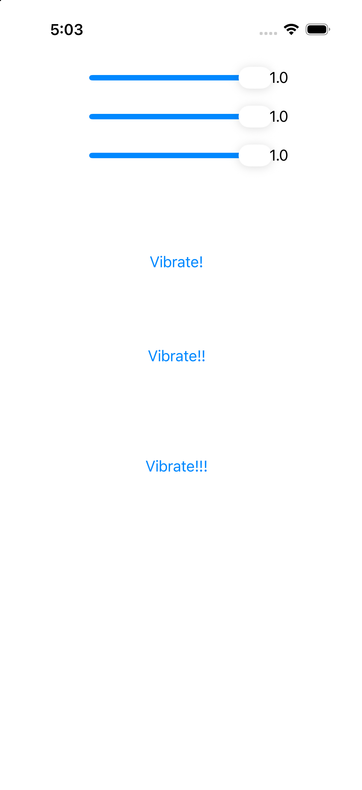

# Vibrate Tester

iOS의 세 가지 진동 API를 한 화면에서 호출해 보는 Swift·UIKit 샘플 앱입니다. 길이·강도·Sharpness 슬라이더를 움직이고 각 API의 버튼을 눌러 구현 방식에 따른 차이를 살펴볼 수 있습니다.

시뮬레이터에서 실행한 초기 화면입니다. 슬라이더는 위부터 길이·강도·Sharpness 순서이며 각각 0~1 범위의 값을 받습니다.

## 비교하는 구현

같은 입력을 받더라도 각 API에 전달하는 방식은 다릅니다.

| 버튼 | 구현 | 이 샘플에서 입력을 사용하는 방식 |
| --- | --- | --- |
| `Vibrate!` | 기본 선택 경로(iOS 13 이상 Core Haptics) | 강도와 Sharpness를 이벤트 파라미터로 전달합니다. 길이가 있으면 연속 이벤트, 없으면 단발 이벤트를 생성합니다. |
| `Vibrate!!` | UIImpactFeedbackGenerator | 강도 입력으로 `light`·`medium`·`heavy` 스타일을 선택합니다. 길이와 Sharpness는 사용하지 않습니다. |
| `Vibrate!!!` | AudioServicesPlaySystemSound | 강도 입력 구간에 따라 시스템 사운드 ID를 선택합니다. 길이와 Sharpness는 사용하지 않습니다. |

`VibrateUtil`이 공통 호출을 받고, `VibrateProtocol`을 구현한 클래스가 각 API를 호출합니다. 화면에서 길이 0은 단발 이벤트, 강도·Sharpness 0은 파라미터 생략으로 처리합니다.

## 실행과 확인

1. 저장소를 내려받아 `test.vibrate.xcodeproj`를 Xcode에서 엽니다.
2. `test.vibrate` scheme에서 서명할 개발 팀과 연결한 iPhone을 선택합니다.
3. 앱을 실행하고 슬라이더 값과 API 버튼을 바꾸며 비교합니다.

화면 구성은 시뮬레이터에서, 진동 차이는 해당 기능을 지원하는 iPhone에서 비교합니다.

## 코드를 읽을 때

- [`ViewController.swift`](test.vibrate/ViewController.swift): 슬라이더 입력, 0값 처리와 각 버튼의 호출을 담당합니다.
- [`HapticUtil.swift`](test.vibrate/HapticUtil.swift): 공통 인터페이스와 세 API 구현을 담습니다.
- [`Main.storyboard`](test.vibrate/Base.lproj/Main.storyboard): 버튼·슬라이더와 화면 코드의 연결을 확인할 수 있습니다.

Core Haptics 구현에는 하드웨어 지원 확인과 엔진 시작·중지·재설정 처리도 들어 있습니다.
